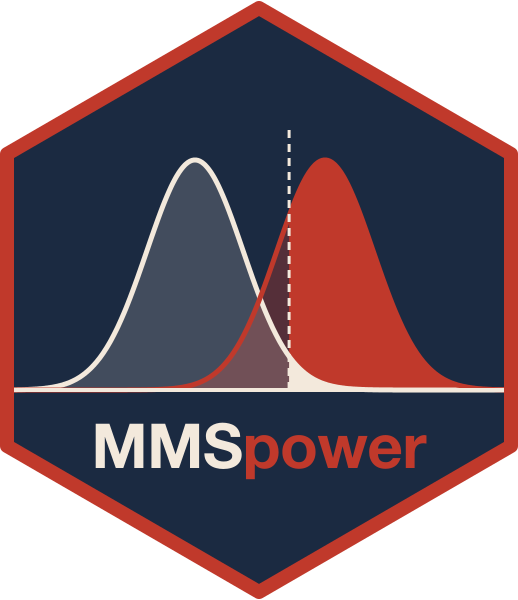

<!-- README.md is generated from README.Rmd. Please edit that file -->

```{r, include = FALSE}
knitr::opts_chunk$set(
  collapse = TRUE,
  comment = "#>",
  fig.path = "man/figures/README-",
  out.width = "100%"
)
```

# MMSpower 

<!-- badges: start -->
[](https://github.com/mrc-ide/MMSpower/actions/workflows/R-CMD-check.yaml)
<!-- badges: end -->

> **Documentation, tutorials and function reference are on the package
> website: <https://mrc-ide.github.io/MMSpower/>**

MMSpower provides simple sample size, power and analysis calculations for
malaria molecular surveillance (MMS) studies. It allows for imperfect
diagnostic tests (sensitivity and specificity) and for clustered sampling
across sites (intra-cluster correlation and the design effect).

## Installation

Install the latest release from GitHub with:

``` r
# install.packages("remotes")
remotes::install_github("mrc-ide/MMSpower")
```

or the development version with
`remotes::install_github("mrc-ide/MMSpower@develop")`.

## Example

How many samples are needed to estimate a prevalence of around 30% to
within ±5 percentage points, sampling 10 people per site with an ICC of
0.05?

```{r example}
library(MMSpower)

design_precision(prevalence = 0.3, moe = 0.05, n_per_site = 10, icc = 0.05)
```

See the [website](https://mrc-ide.github.io/MMSpower/) for worked
tutorials covering each type of study.
