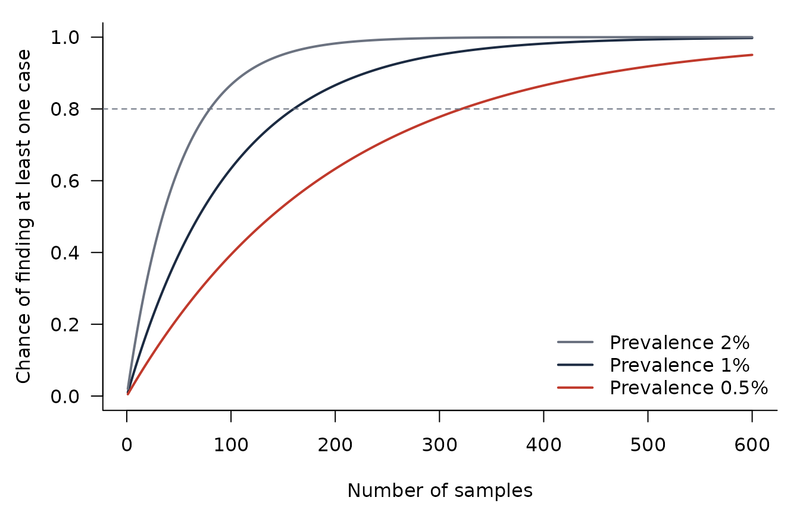

# Detecting a rare variant

``` r

library(MMSpower)
```

Some surveillance questions are not about how common a variant is, but
whether it is there at all. A programme may want to know whether a new
drug-resistance mutation has arrived in a region, or whether *pfhrp2/3*
deletions are present before planning a full prevalence survey. The aim
is then to design a survey large enough that, if the variant is present
at some low prevalence, at least one case is very likely to be found.

[`design_detection()`](https://mrc-ide.github.io/MMSpower/reference/design_detection.md)
answers this. Given a full design instead, such as a survey that has
already been done, it returns `detection_prob`: how likely that survey
was to find the variant.

## Part 1: Designing the study

### How many samples?

Suppose the programme wants an 80% chance of finding at least one case
if the mutation is present in 1% of infections:

``` r

d0 <- design_detection(prevalence = 0.01)
d0
#> $n
#> [1] 161
#> 
#> $n_sites
#> NULL
#> 
#> $n_per_site
#> NULL
#> 
#> $deff
#> [1] 1
#> 
#> $n_eff
#> [1] 161
#> 
#> $detection_prob
#> [1] 0.8017257
```

So 161 samples are needed. The calculation is simple: each sample has a
1% chance of being a case, so the chance of missing every case among
$`n`$ samples is $`(1 - 0.01)^n`$, and $`n`$ is chosen to make that at
most 20%.

The answer depends strongly on the target detection probability and on
the prevalence of the variant to be detected:

``` r

design_detection(prevalence = 0.01, detection_prob = 0.95)$n
#> [1] 299
design_detection(prevalence = 0.005)$n
#> [1] 322
design_detection(prevalence = 0.02)$n
#> [1] 80
```

Raising the detection probability from 80% to 95% takes 299 samples.
Halving the prevalence of the variant to 0.5% roughly doubles the sample
size, and doubling it to 2% roughly halves it. The plot shows the chance
of finding at least one case for different sample sizes:

``` r

n_grid <- 1:600
par(mar = c(4.5, 4.5, 1, 1), las = 1, bty = "l")
plot(n_grid, 1 - (1 - 0.01)^n_grid, type = "l", lwd = 2, col = "#1B2A41",
     ylim = c(0, 1), xlab = "Number of samples",
     ylab = "Chance of finding at least one case")
lines(n_grid, 1 - (1 - 0.005)^n_grid, lwd = 2, col = "#C0392B")
lines(n_grid, 1 - (1 - 0.02)^n_grid, lwd = 2, col = "#6B7280")
abline(h = 0.8, lty = 2, col = "#6B7280")
legend("bottomright", bty = "n", lwd = 2,
       col = c("#6B7280", "#1B2A41", "#C0392B"),
       legend = c("Prevalence 2%", "Prevalence 1%", "Prevalence 0.5%"))
```



To have an 80% chance of detecting at least one case, you would need 80
samples at a variant prevalence of 2%, 161 at 1%, and 322 at 0.5%.

### An imperfect test

A case is only found if the test detects it. With a sensitivity of 90%
and a prevalence of 1%, each sample has a $`0.01 \times 0.9`$ chance of
being a detected case:

``` r

d_test <- design_detection(prevalence = 0.01, sensitivity = 0.9)
d_test$n
#> [1] 179
```

The sample size rises from 161 to 179. Specificity is not used: a
positive result is assumed to be confirmed (for example by sequencing)
before the variant is declared present, so a false positive does not
count as finding a case.

### Clustering

Rare variants are often found in pockets: a new mutation may be common
in one district and absent from the next. In that case, testing many
people at one site mostly repeats what that site has already shown, and
a survey needs to reach many sites to find the variant. As in the other
design functions, this is described by the intra-cluster correlation
(ICC). Here we assume an ICC of 0.05.

**Fixing people per site.** If each site can collect 20 samples:

``` r

d_per <- design_detection(prevalence = 0.01, n_per_site = 20, icc = 0.05)
d_per
#> $n
#> [1] 240
#> 
#> $n_sites
#> [1] 12
#> 
#> $n_per_site
#> [1] 20
#> 
#> $deff
#> [1] 1.438433
#> 
#> $n_eff
#> [1] 161
#> 
#> $detection_prob
#> [1] 0.8130438
```

The study needs 12 sites of 20 people, 240 samples in total, compared
with 161 with no clustering.

**Fixing the number of sites.** If the programme can visit 10 sites:

``` r

d_sites <- design_detection(prevalence = 0.01, n_sites = 10, icc = 0.05)
d_sites
#> $n
#> [1] 250
#> 
#> $n_sites
#> [1] 10
#> 
#> $n_per_site
#> [1] 25
#> 
#> $deff
#> [1] 1.541534
#> 
#> $n_eff
#> [1] 161
#> 
#> $detection_prob
#> [1] 0.8040557
```

Each of the 10 sites now needs 25 people, 250 samples in total.

**More sites, fewer samples.** As for estimating prevalence, spreading
the samples over more sites reduces the total needed:

``` r

d5  <- design_detection(prevalence = 0.01, n_sites = 5, icc = 0.05)
d20 <- design_detection(prevalence = 0.01, n_sites = 20, icc = 0.05)
c(sites_5 = d5$n, sites_10 = d_sites$n, sites_20 = d20$n)
#>  sites_5 sites_10 sites_20 
#>      410      250      200
```

Going from 5 to 20 sites cuts the total from 410 to 200, closer to the
161 an unclustered survey needs. Beyond that, adding sites shrinks the
people per site toward just a few, and because that number rounds up to
a whole person at every site, the total barely falls further.

With few sites and strong clustering, the numbers can become
impractical. With only 3 sites and an ICC of 0.3, the variant may simply
be absent from all three, and no practical number of people per site
makes up for that:

``` r

design_detection(prevalence = 0.01, n_sites = 3, icc = 0.3)$n_per_site
#> [1] 17821858014
```

The answer is technically finite but far beyond any real survey. A fix
is to add more sites.

### Allowing for dropout and suspected cases

As with the other design functions,
[`design_detection()`](https://mrc-ide.github.io/MMSpower/reference/design_detection.md)
gives the number of samples needed **at analysis**. To reach it, inflate
for expected losses (withdrawn consent, lost or failed samples) and, if
the variant is looked for only in confirmed infections, for the share of
suspected cases that are confirmed. With 10% losses and 40% of suspected
cases confirmed:

``` r

n_analysis  <- d0$n
n_confirmed <- ceiling(n_analysis / (1 - 0.1))
n_suspected <- ceiling(n_confirmed / 0.4)
c(suspected = n_suspected, confirmed = n_confirmed, analysis = n_analysis)
#> suspected confirmed  analysis 
#>       448       179       161
```

So 448 suspected cases are enrolled, 179 confirmed cases are expected
among them, and 161 samples should reach the analysis. Each step uses
[`ceiling()`](https://rdrr.io/r/base/Round.html) to round up, since you
cannot enrol part of a person and rounding down would leave the study
short. With sites, do this per site rather than only for the total, so
that every site still delivers its share. The [Estimating
prevalence](https://mrc-ide.github.io/MMSpower/articles/tutorial-prevalence.md)
tutorial works through this in more detail, including confirmed
fractions that differ by site.

## Part 2: Interpreting a survey that found nothing

Suppose 300 samples were tested and no case of the mutation was found.
How reassuring is that? Give the full design, here `n = 300`, and the
function returns `detection_prob`, the chance that the survey would have
found the variant if it were present at 1%:

``` r

r0 <- design_detection(prevalence = 0.01, n = 300)
r0$detection_prob
#> [1] 0.9509591
```

If the 300 samples were a simple random sample, there was a 95% chance
of finding a 1% variant, so finding none is good evidence that the
prevalence is below 1%. But if the 300 samples came from clusters, for
example 15 sites of 20 people, with an ICC of 0.05:

``` r

r_sites <- design_detection(prevalence = 0.01, n_sites = 15, n_per_site = 20,
                            icc = 0.05)
r_sites$detection_prob
#> [1] 0.8770652
```

the chance falls to 88%. The same number of negative results is weaker
evidence when they come from clusters, because a variant concentrated
elsewhere could have been missed entirely. When reporting that a variant
was not found, state the prevalence it could have been detected at, and
with what chance.
