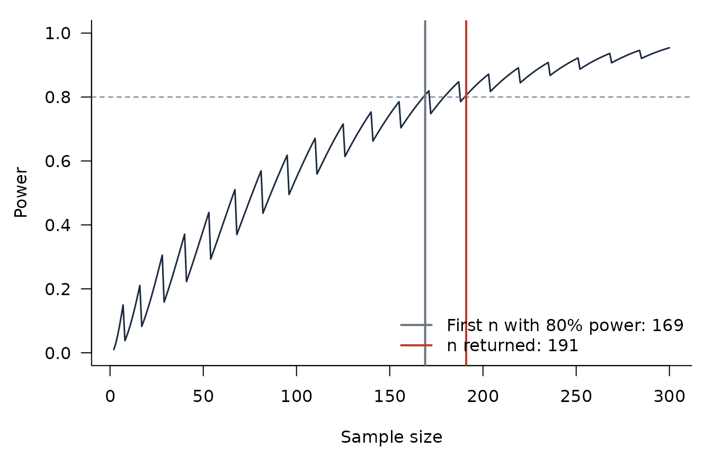

# Testing against a threshold

``` r

library(MMSpower)
```

Some surveillance questions are not “what is the prevalence?” but “is it
above a level that calls for action?”. The standard example is
*pfhrp2/3* gene deletions. Parasites lacking these genes are missed by
HRP2-based rapid diagnostic tests, and WHO recommends switching to a
different test once the prevalence of deletions causing false-negative
results is above 5%. A programme suspects deletions are around 10% in
one region and wants a survey that will show prevalence is above 5% if
that is true.

[`design_threshold()`](https://mrc-ide.github.io/MMSpower/reference/design_threshold.md)
gives the sample size, and
[`test_threshold()`](https://mrc-ide.github.io/MMSpower/reference/test_threshold.md)
analyses the data. Both use an exact binomial test by default.

## How many samples?

Power is the chance that the survey correctly shows prevalence is above
the threshold, when the true prevalence is above it. The usual target is
80%. Take the simplest case first: no clustering, a perfect test, a 5%
threshold, and an expected prevalence of 10%:

``` r

d0 <- design_threshold(threshold = 0.05, prevalence = 0.10)
d0
#> $n
#> [1] 191
#> 
#> $n_sites
#> NULL
#> 
#> $n_per_site
#> NULL
#> 
#> $deff
#> [1] 1
#> 
#> $n_eff
#> [1] 191
#> 
#> $power
#> [1] 0.8053581
```

So 191 samples are needed. `power` is the power this rounded design
actually achieves, 0.805, just above the 0.8 target. The gap between the
expected prevalence and the threshold is what matters most: the closer
the true prevalence is to 5%, the harder it is to tell apart from 5%,
and the sample size grows quickly.

## Why power is a saw-tooth

With an exact test, power does not always go up when samples are added.
The test declares “above 5%” only once the number of positive samples
reaches a cut-off. That cut-off is a whole number, so as the sample size
grows it holds steady and then steps up by one; each step makes “above
5%” harder to reach, so power dips a little before climbing again. The
plot shows exact power for every sample size from 2 to 300, for a true
prevalence of 10% against the 5% threshold.

``` r

n_grid <- 2:300
pw <- numeric(length(n_grid))
for (i in seq_along(n_grid)) {
  pw[i] <- design_threshold(threshold = 0.05, prevalence = 0.10,
                            n_sites = 1, n_per_site = n_grid[i])$power
}
n_first <- min(n_grid[pw >= 0.8])

par(mar = c(4.5, 4.5, 1, 1), las = 1, bty = "l")
plot(n_grid, pw, type = "l", lwd = 1.5, col = "#1B2A41", ylim = c(0, 1),
     xlab = "Sample size", ylab = "Power")
abline(h = 0.8, lty = 2, col = "#6B7280")
abline(v = c(n_first, d0$n), col = c("#6B7280", "#C0392B"), lwd = 2)
legend("bottomright", bty = "n",
       legend = c(paste("First n with 80% power:", n_first),
                  paste("n returned:", d0$n)),
       col = c("#6B7280", "#C0392B"), lwd = 2)
```



Power first reaches 80% at n = 169, but at several larger sample sizes
it falls back below 80%.
[`design_threshold()`](https://mrc-ide.github.io/MMSpower/reference/design_threshold.md)
returns 191, the smallest sample size from which power **never** drops
back below the target. This is the safe choice: in the field, a few
samples are always lost or added (failed extractions, an extra day at a
site), and with the returned size none of this can push the study below
80% power.

## Showing prevalence is below a threshold

The question can also run the other way. After a switch of test, a
programme may want to confirm that deletions are now **below** 5%. Use
`alternative = "less"`, with the expected prevalence below the
threshold:

``` r

design_threshold(threshold = 0.05, prevalence = 0.02, alternative = "less")$n
#> [1] 286
```

The burden of proof is reversed. A one-sided test only concludes what it
sets out to show when the evidence is strong, so failing to show
prevalence is *above* 5% is not the same as showing it is *below* 5%,
the data may simply be inconclusive. Each direction is a separate test
with its own sample size.

## An imperfect test

The assay used to call a deletion is not perfect. Suppose it detects 90%
of true deletions (sensitivity) and correctly clears 98% of true
non-deletions (specificity):

``` r

d_test <- design_threshold(threshold = 0.05, prevalence = 0.10,
                           sensitivity = 0.9, specificity = 0.98)
d_test$n
#> [1] 277
```

The sample size rises from 191 to 277. Power depends on the gap between
the prevalence (10%) and the threshold (5%): a smaller gap needs more
samples. An imperfect test measures both on the scale of what would test
positive, which pulls 10% and 5% closer together by a factor of
$`Se + Sp - 1`$, so the gap shrinks and more samples are needed.

## Clustering

In practice samples come from sites, and, as in the [Estimating
prevalence](https://mrc-ide.github.io/MMSpower/articles/tutorial-prevalence.md)
tutorial, an ICC above 0 means more samples are needed. With 20 samples
per site and an ICC of 0.05, solve for the number of sites:

``` r

d_ps <- design_threshold(threshold = 0.05, prevalence = 0.10,
                         n_per_site = 20, icc = 0.05)
d_ps
#> $n
#> [1] 380
#> 
#> $n_sites
#> [1] 19
#> 
#> $n_per_site
#> [1] 20
#> 
#> $deff
#> [1] 1.95
#> 
#> $n_eff
#> [1] 191
#> 
#> $power
#> [1] 0.8238663
```

This needs 19 sites of 20 samples, 380 in total, against the 191 a
simple random sample would need.

Or fix the number of sites at 15 and solve for the samples per site:

``` r

d_ns <- design_threshold(threshold = 0.05, prevalence = 0.10,
                         n_sites = 15, icc = 0.05)
d_ns
#> $n
#> [1] 510
#> 
#> $n_sites
#> [1] 15
#> 
#> $n_per_site
#> [1] 34
#> 
#> $deff
#> [1] 2.65
#> 
#> $n_eff
#> [1] 191
#> 
#> $power
#> [1] 0.8116771
```

This needs 34 samples per site, 510 in total. Both examples report the
same `n_eff`, 191.

To find the power of a design you already have, give the full design and
leave out `power`:

``` r

p15 <- design_threshold(threshold = 0.05, prevalence = 0.10,
                        n_sites = 15, n_per_site = 20, icc = 0.05)$power
p15
#> [1] 0.7700449
```

Fifteen sites of 20 samples give a power of 0.77, short of the 0.80
target: this design is a little too small, which is why solving for the
number of sites above returned 19 sites.

As with
[`design_precision()`](https://mrc-ide.github.io/MMSpower/reference/design_precision.md),
too few sites make the target unreachable, because each site is worth at
most $`1/\text{ICC}`$ independent samples:

``` r

design_threshold(threshold = 0.05, prevalence = 0.10,
                 n_sites = 8, icc = 0.05)
#> Error:
#> ! Target power is unreachable with 8 sites and ICC = 0.05: the sites are worth at most 160 independent people, but 191 are needed. Increase `n_sites` or lower the target power.
```

These sample sizes assume the data will be analysed with the same ICC
used to design them (0.05). If the analysis instead estimates the ICC
and it comes out higher, the effective sample size is smaller and the
true power falls below the target.

## Analysing the data

The survey is now complete: 19 sites of 20 samples. We want to assess
whether the prevalence is above the 5% threshold.
[`test_threshold()`](https://mrc-ide.github.io/MMSpower/reference/test_threshold.md)
takes the number of samples with a deletion (`x`) and the number tested
(`n`) at each site:

``` r

x <- c(0, 4, 1, 0, 5, 3, 1, 4, 2, 6, 0, 2, 4, 0, 1, 5, 1, 3, 2)
n <- rep(20, 19)
res <- test_threshold(x, n, threshold = 0.05)
res
#> $p_value
#> [1] 0.0002297787
#> 
#> $reject
#> [1] TRUE
#> 
#> $prevalence
#> [1] 0.1157895
#> 
#> $ci_lower
#> [1] 0.07975905
#> 
#> $ci_upper
#> [1] 1
#> 
#> $n_eff
#> [1] 211.8726
#> 
#> $icc
#> [1] 0.04176477
#> 
#> $deff
#> [1] 1.793531
#> 
#> $df
#> [1] 18
```

The estimated prevalence is 11.6%, and the p-value is 0.00023, so
`reject` is TRUE: the data show prevalence is above 5%. The ICC has been
estimated from the sites (0.042), and the test is based on the effective
sample size `n_eff` rather than the 380 samples tested. Because the ICC
was estimated, the test also allows for the uncertainty in that
estimate, using `df` (the number of sites minus one): with few sites it
becomes more cautious.

### The one-sided interval

Because the question is one-sided (“is it above 5%?”), the interval is
one-sided too: it runs from `ci_lower` = 8% up to 100%. It holds every
threshold the test would not reject, so `reject` is `TRUE` exactly when
the threshold lies outside the interval. Here 5% is below `ci_lower`,
which agrees with the test.

### Exact or Wald?

The Wald test uses a normal approximation in place of the exact test’s
binomial distribution when the ICC is supplied. When the ICC is
estimated, it uses a t distribution with `df` (sites minus one) instead
of the normal, to allow for the uncertainty in the estimated clustering.
`res_wald` is the previous analysis redone with the Wald method; compare
its p-value and lower bound with the exact test’s (`res`):

``` r

res_wald <- test_threshold(x, n, threshold = 0.05, method = "wald")
rbind(exact = unlist(res[c("p_value", "ci_lower")]),
      wald  = unlist(res_wald[c("p_value", "ci_lower")]))
#>            p_value   ci_lower
#> exact 0.0002297787 0.07975905
#> wald  0.0039031119 0.07767061
```

With this much data the two reach the same conclusion, with similar
lower bounds, although their p-values differ. They can differ especially
with small samples or a prevalence near 0, which is common for deletion
surveys. An extreme case is a single site of 20 samples with no
deletions, tested for being below 5%:

``` r

exact <- test_threshold(0, 20, threshold = 0.05, alternative = "less")
wald  <- test_threshold(0, 20, threshold = 0.05, alternative = "less",
                        method = "wald")
rbind(exact = unlist(exact[c("p_value", "reject", "ci_upper")]),
      wald  = unlist(wald[c("p_value", "reject", "ci_upper")]))
#>         p_value reject  ci_upper
#> exact 0.3584859      0 0.1391083
#> wald  0.0000000      1 0.0000000
```

With no positives, the Wald standard error is 0, so the Wald interval
has zero width and any threshold above 0 is rejected: it claims proof
that prevalence is below 5% from just 20 samples. The exact test does
not, and its interval runs up to 13.9%. This is why `"exact"` is the
default.

### Supplying the ICC

Previously the ICC was estimated from the data. It can also be supplied,
for example from earlier studies; here we assume an ICC of 0.05:

``` r

res_icc <- test_threshold(x, n, threshold = 0.05, icc = 0.05)
round(unlist(res_icc), 4)
#>    p_value     reject prevalence   ci_lower   ci_upper      n_eff        icc 
#>     0.0002     1.0000     0.1158     0.0801     1.0000   194.8718     0.0500 
#>       deff         df 
#>     1.9500        Inf
```

The supplied ICC appears as `icc` in the output, and `df` is now `Inf`:
a known ICC carries no uncertainty, so the test adds no extra caution
for it. When the ICC was estimated, `df` was the number of sites minus
one, which made the test more cautious, and `n_eff` differs too because
it depends on the ICC.

Supplying the ICC or estimating it makes no difference to the
false-alarm rate: either way the test wrongly declares “above 5%” at
most 5% of the time. What changes is power. The caution the test takes
for an uncertain estimated ICC, the finite `df` above, costs power, so a
real excess is harder to detect. A trustworthy ICC from earlier surveys
avoids that cost.

## When to use DRpower instead

For *pfhrp2/3* deletion surveys with several sites and an unknown ICC,
consider the [DRpower](https://mrc-ide.github.io/DRpower/) package
instead. DRpower fits a Bayesian beta-binomial model that estimates the
prevalence and the ICC together, rather than fixing the ICC or plugging
in a single estimate. It carries the uncertainty about the ICC through
to the prevalence, and answers the threshold question directly, from the
posterior probability that prevalence is above 5%. The pay-off is more
power, especially with few sites; the cost is more false alarms when the
true prevalence is close to the threshold.

MMSpower is the better choice when you can supply the ICC from earlier
surveys, or when you want a standard frequentist test whose false-alarm
rate is held at or below the stated level.
